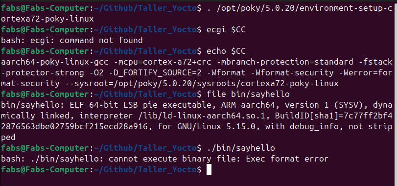
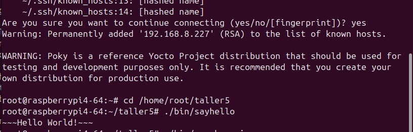
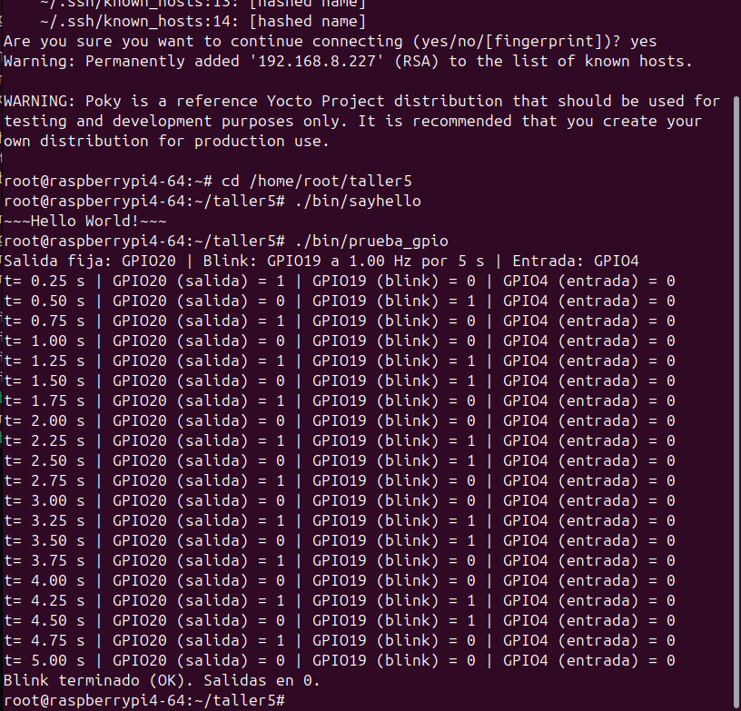

# Taller 5 — Yocto Project parte II

CE1113 Sistemas Empotrados — Instituto Tecnológico de Costa Rica

## Integrantes

| Nombre |
|---|
| Fabiola Meléndez 2023205341| 
| Irene Muñoz 2023205342| 
| Jeremy Serracín 2023205343| 
| Marco Villatoro 2023205344| 

## Contenido

```
taller5_gpio/
├── include/gpio_rpi.h         API de la biblioteca
├── src/gpio_rpi.c             la biblioteca (libgpio_rpi.so)
├── src/main.c                 prueba (prueba_gpio)
├── lib/                       aquí queda libgpio_rpi.so al compilar
├── bin/                       aquí quedan prueba_gpio y sayhello al compilar
├── test_toolchain/helloworld.c  prueba del toolchain (sección 3)
├── scripts/compilar.sh        script carga el SDK de Yocto y compila todo
├── scripts/desplegar.sh       script copia bin/ y lib/ a la Raspberry Pi por SSH
├── capturas/                  evidencias (capturas de pantalla)
├── Makefile
└── README.md
```

---

## 1. Imagen y toolchain (tutorial, secciones 2 y 3)

Se usó la imagen y el SDK que el grupo generó para el proyecto Roomba-Disco, con Yocto Scarthgap (Poky 5.0.20). Hay dos diferencias con el enunciado:

1ra: se usa `MACHINE ?= "raspberrypi4-64"` en lugar del `MACHINE ?= "raspberrypi4"` pues fue el usado para el proyecto, el de 64bits.

2do: Se usó `bitbake core-image-minimal` en lugar del `bitbake rpi-test-image`, igual para reutilizar el código del proyecto que ya tenemos cargado.


Generación del SDK e instalación:

```bash
# Ruta: <directorio-de-build>/rpi4   (después de: source oe-init-build-env rpi4)
bitbake core-image-minimal -c populate_sdk
ls tmp/deploy/sdk/                     # instalador poky-glibc-x86_64-...-toolchain-5.0.20.sh
./tmp/deploy/sdk/poky-glibc-x86_64-*-toolchain-5.0.20.sh     # instala en /opt/poky/5.0.20 por defecto
```

Prueba del toolchain:

```bash
# Ruta: raíz de taller5_gpio
. /opt/poky/5.0.20/environment-setup-cortexa72-poky-linux
echo $CC
# aarch64-poky-linux-gcc -mcpu=cortex-a72+crc -mbranch-protection=standard -fstack-protector-strong
#   -O2 -D_FORTIFY_SOURCE=2 -Wformat -Wformat-security -Werror=format-security
#   --sysroot=/opt/poky/5.0.20/sysroots/cortexa72-poky-linux
$CC -o bin/sayhello test_toolchain/helloworld.c      # (o: make sayhello)
file bin/sayhello
# bin/sayhello: ELF 64-bit LSB executable, ARM aarch64, ...
./bin/sayhello
# bash: ./bin/sayhello: cannot execute binary file: Exec format error
```




## Preguntas del tutorial
### ¿Por qué no debería verse "Hello World!" en la PC? ¿Qué quiere decir la salida?

Porque `sayhello` se compiló con el compilador cruzado `aarch64-poky-linux-gcc` que es un ejecutable ELF con las instrucciones ARM de 64 bits (AArch64), mientras que la PC tiene un procesador x86_64. Entonces el mensaje `cannot execute binary file: Exec format error` es el error `ENOEXEC` del kernel. Indica que el archivo sí es un ejecutable ELF, pero para una arquitectura que el procesador no puede ejecutar. Lo que muestra es que la compilación cruzada funcionó: el binario se generó en la PC, pero es para la Raspberry Pi, por eso no corrió.


### Ejecución en la Raspberry Pi

En lugar de copiar el binario a la microSD con la tarjeta fuera, se copió por SSH, con la Pi corriendo la imagen.

```bash
# Ruta: /home/root/taller5 (en la Raspberry Pi)
./bin/sayhello
# Hello World
```




### ¿Cuál es la salida en este caso? ¿Qué quiere decir?

La salida es `~~~Hello World!~~~`. En la Raspberry Pi la arquitectura del binario coincide con la del procesador (Cortex-A72, AArch64), y el programa encuentra en la imagen la misma `glibc` contra la que se enlazó, porque el SDK se generó desde esa misma imagen. Esto confirma el desarrollo cruzado: se compila en la PC (host) y se ejecuta en la rasp (target).

---

## 2. Investigación

### 2.1 ¿Qué pasos debe seguir antes de escribir o leer de un puerto de entrada/salida general (GPIO)?

En Linux un programa no accede directo a los registros del GPIO: le pide al kernel el pin y lo configura. Hay dos interfaces.

**a) Interfaz por dispositivo de caracteres (`/dev/gpiochipN`), la actual.** Es la que usa esta biblioteca, mediante `libgpiod`:

1. **Abrir el chip GPIO** que controla el pin. En la Raspberry Pi 4 los GPIO del conector son el `/dev/gpiochip0`, y el número BCM del pin es el número de línea dentro del chip (GPIO17 = línea 17).
2. **Solicitar la línea** e indicar su configuración: dirección (entrada o salida), valor inicial si es salida y, si hace falta, resistencias de pull-up o pull-down. Mientras el proceso tenga la línea, ningún otro proceso puede usarla.
3. **Leer o escribir** el valor.
4. **Liberar la línea** al terminar (si el proceso termina, el kernel la libera solo).

**b) Interfaz sysfs (`/sys/class/gpio`), obsoleta.** El kernel la marca como obsoleta desde la versión 4.8, pero todavía se usa en ejemplos:

1. **Exportar el pin:** `echo N > /sys/class/gpio/export` crea `/sys/class/gpio/gpioN/`.
2. **Configurar la dirección:** `echo out > /sys/class/gpio/gpioN/direction` (o `in`).
3. **Leer o escribir:** `cat /sys/class/gpio/gpioN/value` o `echo 1 > /sys/class/gpio/gpioN/value`.
4. **Liberar el pin:** `echo N > /sys/class/gpio/unexport`.

En el kernel 6.6 de la Raspberry Pi, el número `N` de sysfs **no** es el número BCM: el `gpiochip0` empieza en una base de 512, así que el GPIO17 se exporta como 529. La base se consulta con `cat /sys/class/gpio/gpiochip*/base`. Además, sysfs solo existe si el kernel se compiló con `CONFIG_GPIO_SYSFS`.

### 2.2 ¿Qué comando podría utilizar, bajo Linux, para escribir a un GPIO específico?

Con las herramientas de `libgpiod` (paquete `libgpiod-tools`, versión 2.x), para poner el GPIO17 en alto:

```bash
gpioset -c gpiochip0 17=1        # escribe 1 en el GPIO17 (Ctrl+C para soltar la línea)
gpioget -c gpiochip0 17          # lee el GPIO17
```

En la versión 2 de `gpioset`, el comando mantiene el valor mientras sigue corriendo; al terminar suelta la línea.

Con sysfs, en un kernel que lo tenga habilitado. Se necesitan permisos de root: en Raspberry Pi OS hay que pasar a superusuario con `sudo su`, porque `sudo echo 1 > archivo` no funciona (la redirección `>` la hace la shell del usuario, sin permisos). En la imagen de Yocto del proyecto ya se entra como root.

Primero se exporta el GPIO al espacio de usuario. En la Raspberry Pi 4 con kernel 6.6 el número es 512 + BCM, así que el GPIO20 es el 532:

```bash
echo 532 > /sys/class/gpio/export
```

Eso crea el directorio `/sys/class/gpio/gpio532/`. Adentro, el archivo `direction` define si el GPIO es entrada o salida, y `value` tiene su valor:

```bash
cd /sys/class/gpio/gpio532
echo out > direction       # salida
echo 1 > value             # alto (3.3 V); 0 = bajo (0 V)
```

Para liberar el pin:

```bash
echo 532 > /sys/class/gpio/unexport
```

---

## 3. Ejercicio práctico: biblioteca `libgpio_rpi.so`

### 3.1 `include/gpio_rpi.h`

 `int pinMode(int pin, gpio_mode_t mode)`: Configura el pin como `GPIO_INPUT` o `GPIO_OUTPUT`. Las salidas arrancan en 0. Las entradas quedan con pull-down interno (sin conectar se leen 0).

 `int digitalWrite(int pin, int value)`: Escribe 0 o 1 en un pin configurado como salida. 

 `int digitalRead(int pin)`: Devuelve 0 o 1 (o -1 si hubo error).

 `int blink(int pin, double freq, double duration)`: Alterna el pin a `freq` Hz (ciclos completos por segundo) durante `duration` segundos y lo deja en 0. Si el pin no estaba configurado, lo configura como salida. Es bloqueante.

 `void gpio_rpi_cleanup(void)`: Libera todos los pines y cierra el chip. 

Todas las funciones que devuelven `int` retornan 0 si todo salió bien y -1 si hubo error. `pin` es el número BCM.

**Decisiones tomadas:**

- Se usa `libgpiod` v2 sobre `/dev/gpiochip0`, que es la interfaz actual del kernel. Ya viene en la imagen del proyecto y, por lo tanto, también en el sysroot del SDK.
- Un mutex protege la tabla de pines, para que `blink()` pueda correr en un hilo mientras el programa principal escribe o lee otros pines.
- `blink()` calcula cada cambio de estado como un instante absoluto (`clock_nanosleep` con `TIMER_ABSTIME`). Así, el tiempo que tarda cada escritura no se acumula y la frecuencia y la duración se mantienen exactas.

### 3.2 Aplicación de prueba (`src/main.c`)

`prueba_gpio [salida1 salida2 entrada frecuencia_hz]`:

- Configura `salida1` y `salida2` como salidas y `entrada` como entrada.
- En un hilo, hace `blink` en `salida2` a la frecuencia indicada durante **5 s**.
- Mientras tanto, cada 0.25 s escribe 1, 0, 1, 0… en `salida1`, lee `entrada` y muestra los tres valores en pantalla.
- Al terminar, deja las salidas en 0 y libera los pines.

Sin argumentos usa los valores default. Son pines libres en el robot Roomba-Disco, así que la prueba se puede correr con el servicio `logica` activo:

| Señal | GPIO (BCM) | Pin físico |
|---|---|---|
| Salida 1 (valores 0/1) | GPIO20 | 38 |
| Salida 2 (blink, 1 Hz) | GPIO19 | 35 |
| Entrada | GPIO4 | 7 |
| GND | — | 39 (o 6, 9, 14...) |
| 3.3 V | — | 1 o 17 |

**Conexión sugerida (con la Raspberry apagada):**

- **Cada salida:** un LED con su resistencia en serie (220 a 330 Ω), del pin de salida a GND (el ánodo del LED hacia el pin).
- **Entrada:** un cable del pin 7 a 3.3 V (pin 1) para leer 1; suelto se lee 0 por el pull-down. 

**¡¡¡OJO!!! - Nunca conectar a 5 V:** los GPIO de la Raspberry son de 3.3 V.

### 3.3 Compilación cruzada

```bash
# Ruta: raíz de taller5_gpio
./scripts/compilar.sh                        # usa /opt/poky/5.0.20/environment-setup-cortexa72-poky-linux
# o, a mano:
. /opt/poky/5.0.20/environment-setup-cortexa72-poky-linux
make            # lib/libgpio_rpi.so y bin/prueba_gpio
make sayhello   # bin/sayhello
make info       # muestra el CC y la arquitectura destino (aarch64-poky-linux)
```

Verificación de que son binarios ARM y de sus dependencias:

```bash
# Ruta: raíz de taller5_gpio
file lib/libgpio_rpi.so bin/prueba_gpio
readelf -d bin/prueba_gpio | grep -E 'NEEDED|RUNPATH'
# NEEDED libgpio_rpi.so, libc.so.6 · RUNPATH $ORIGIN/../lib
readelf -d lib/libgpio_rpi.so | grep -E 'NEEDED|SONAME'
# NEEDED libgpiod.so.3, libc.so.6 · SONAME libgpio_rpi.so
```

La aplicación se enlaza con `-Wl,-rpath,'$ORIGIN/../lib'`, así que busca la biblioteca en la carpeta `lib/` que está al lado de `bin/`, sin necesidad de instalarla en `/usr/lib` ni de usar `LD_LIBRARY_PATH`.

### 3.4 Despliegue y ejecución en la Raspberry Pi

```bash
# Ruta: raíz de taller5_gpio (en la PC)
./scripts/desplegar.sh <ip-de-la-pi>         # copia bin/ y lib/ a /home/root/taller5
```

```bash
# Ruta: /home/root/taller5 (en la Raspberry Pi, por SSH)
./bin/prueba_gpio                 # valores por defecto: GPIO20, GPIO19 (1 Hz), GPIO4
./bin/prueba_gpio 20 19 4 2.5     # mismos pines, blink a 2.5 Hz
```

Salida esperada (entrada conectada a 3.3 V):

```text
Salida fija: GPIO20 | Blink: GPIO19 a 1.00 Hz por 5 s | Entrada: GPIO4
t= 0.25 s | GPIO20 (salida) = 1 | GPIO19 (blink) = 0 | GPIO4 (entrada) = 1
t= 0.50 s | GPIO20 (salida) = 0 | GPIO19 (blink) = 1 | GPIO4 (entrada) = 1
...
t= 5.00 s | GPIO20 (salida) = 0 | GPIO19 (blink) = 0 | GPIO4 (entrada) = 1
Blink terminado (OK). Salidas en 0.
```




Si aparece `pinMode (...): Device or resource busy`, otro proceso tiene ese pin (por ejemplo, `logica` si se eligen pines del robot). Hay que usar otros pines o detener el servicio con `systemctl stop servidor logica`.

### 3.5 Entrega

`make entrega` no compila: revisa que `lib/` y `bin/` tengan los binarios y que sean ARM (aarch64), y empaqueta. `make clean` borra los binarios.

```bash
# Ruta: raíz de taller5_gpio
./scripts/compilar.sh                        # binarios ARM frescos
make entrega NOMBRE=Fabiola_Irene_Jeremy_Marco_Eval_Tut_7    # crea ../Fabiola_Irene_Jeremy_Marco_Eval_Tut_7.tar.gz
```
